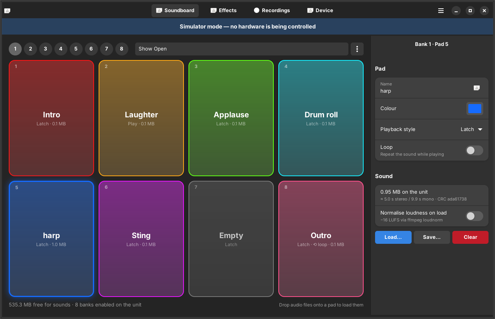

# RØDECaster Pro for Linux



This is an unofficial companion app for the **original RØDECaster Pro (gen 1)**. It replaces
RØDE's macOS/Windows "RØDECaster Pro" app v2.1.2 on Arch Linux and Omarchy. It is a native
GTK4/libadwaita app, so it picks up your Omarchy theme, and it also ships a command-line tool.

> Not affiliated with RØDE. The protocol was reconstructed from the macOS app's binary (see
> [PROTOCOL.md](PROTOCOL.md)) and is now being checked against a real gen-1 unit (firmware 2.x).

### Hardware test status

| Feature | Status on a real unit |
|---------|-----------------------|
| Detect and connect (normal mode and USB transfer mode) | ✅ works |
| Read status, free memory, bank count, bank names, pad name/colour/mode/size | ✅ works |
| Enter Podcast Transfer Mode from the app | ✅ works |
| Browse and export recordings from the card | ✅ works |
| Leave Podcast Transfer Mode from the app | ✅ works |
| Firmware version display | ❌ the unit doesn't answer the version query; shows "unknown" |
| Upload a sound to a pad (MP3 → 48 kHz, plays on the unit) | ✅ works |
| Rename a pad, change pad colour | ✅ works |
| Save a pad's sound to WAV (download from the unit) | ✅ works |
| Clear a pad | ✅ works |
| Rename a bank | ✅ works |
| Effects read/write, settings backup/restore, clock sync | ⚠️ untested |
| Restart unit | ⛔ removed: the restart command reboots the unit into its **bootloader** ("firmware update in progress" screen). Recover by power-cycling or with RØDE's official app |

Try untested write features on pads/settings you can afford to lose, and back up your settings
first once that feature is confirmed.

## What it does

| Area | Features |
|------|----------|
| **Soundboard** | Browse 8 banks × 8 pads and rename banks. Edit pad name, colour, playback style (Latch/Pause/Replay/Play/!@#*/Trash-talk) and loop. Load any audio onto a pad: WAV, MP3, FLAC, OGG and anything else ffmpeg reads, resampled to 48 kHz, with optional −16 LUFS normalisation. You can also drag and drop files onto pads. Save a pad's sound to WAV, clear a pad, clear a bank, restore factory sounds, and see free memory. |
| **Effects** | Read and write the processing block for Mic 1–4 and the master channel: high-pass, gate, de-esser, compressor, APHEX exciter, Big Bottom and the enables. Toggle effects-edit mode, reset to defaults, and save/load presets as JSON. Values are the raw numbers the unit stores. |
| **Recordings** | Enter or leave Podcast Transfer Mode, then find and mount the `RODECASTER` card. List recordings and export them to WAV, FLAC or MP3 with loudness presets. Multitrack recordings can be split into one file per source (mix, Mics 1–4, USB, TRRS, Bluetooth, Sounds). Split files are stitched back together. |
| **Device** | Shows connection details, syncs the clock to the computer (also automatically on connect), backs up and restores `.rcpsettings` files (compatible with RØDE's app), and extracts factory sounds. |

**Not included:** firmware updates. Flashing over a reverse-engineered protocol risks bricking
the unit, so update it once from macOS/Windows instead. The live on-screen mirror of the
console's menus is also not included.

## Install (Arch / Omarchy)

```bash
cd rodecaster-linux
./install.sh          # installs deps, builds a pacman package with makepkg, installs udev rule
```

Unplug and replug the USB cable once. Then launch **RØDECaster Pro** from the launcher
(Super + Space) or run `rodecaster`.

To install manually, run `makepkg -si` in this folder. The dependencies are `python-gobject`,
`gtk4`, `libadwaita` and `ffmpeg`, plus `udisks2` if you want the card mounted for you.

## Install (Debian / Ubuntu)

Needs libadwaita 1.5 or newer: **Ubuntu 24.04+** or **Debian 13 (trixie)+**. Debian 12 is too old.

Download `rodecaster-linux_<version>_all.deb` from the
[Releases page](https://github.com/ClosedNetwork/rodecaster-linux/releases), then:

```bash
sudo apt install ./rodecaster-linux_*_all.deb   # pulls in python3-gi, GTK4, libadwaita, ffmpeg
```

Unplug and replug the USB cable once, then launch **RØDECaster Pro** from your app menu or run
`rodecaster`. To build the package yourself, run `packaging/deb/build-deb.sh`; it writes the
`.deb` to `dist/`.

### Permissions

The package installs `/usr/lib/udev/rules.d/70-rodecaster-pro.rules`. It tags the unit's
hidraw node `uaccess`, so whoever is logged in can access it without root.

## Usage

```bash
rodecaster                 # GUI
rodecaster --simulate      # GUI against a built-in emulator (no hardware needed)
rodecaster-cli info
rodecaster-cli pads --bank 1
rodecaster-cli upload 1 3 ~/Sounds/applause.mp3 --name "Applause"
rodecaster-cli set-pad 1 3 --colour "#ff8800" --mode play --loop off
rodecaster-cli download 1 3 applause.wav
rodecaster-cli settings-backup show.rcpsettings
rodecaster-cli transfer on && rodecaster-cli podcasts --export 1 --split --format "FLAC"
rodecaster-cli -vv raw 08000000        # debug: free-memory query with full HID hex log
```

### Factory sounds

RØDE's eight factory pad sounds are not shipped with this app. If you have the macOS app, copy
`RODECaster Pro.app/Contents/MacOS/RODECaster Pro` over and run:

```bash
rodecaster-cli extract-factory-sounds "/path/to/RODECaster Pro"
```

You can also use Device → Factory sounds → Extract… in the GUI. After that, "Restore factory
sounds" works.

## Troubleshooting

- **"No RØDECaster Pro found":** run `rodecaster-cli list`. If nothing shows up, check the cable
  and `lsusb | grep 19f7`.
- **Permission denied:** reload the udev rules (`sudo udevadm control --reload-rules && sudo udevadm trigger`)
  and replug.
- **Unit freezes on connect:** the Pro II needs the kernel option `usbhid.quirks=0x19f7:<pid>:0x400`.
  If gen 1 behaves the same way, add `usbhid.quirks=0x19f7:0x0011:0x400` to your kernel command line.
- **Audio interface:** the unit is a standard USB Audio Class 2 device. PipeWire picks it up
  with no extra setup.

## Development

```bash
python -m pytest            # protocol, emulator round-trips, ffmpeg export tests
python -m rodecaster --simulate
```

Layout:

- `rodecaster/protocol.py`: wire format (pure)
- `transport.py`: hidraw
- `device.py`: high-level API
- `simulator.py`: emulator
- `ui/`: GTK
